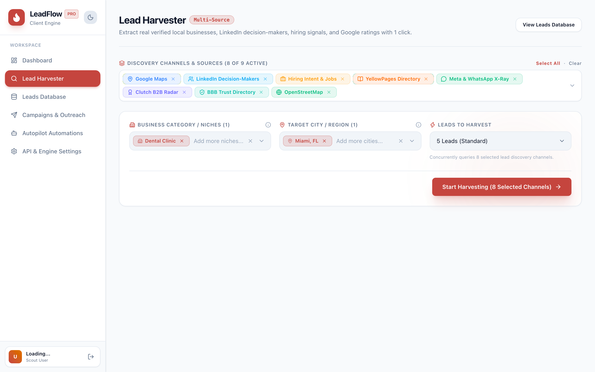
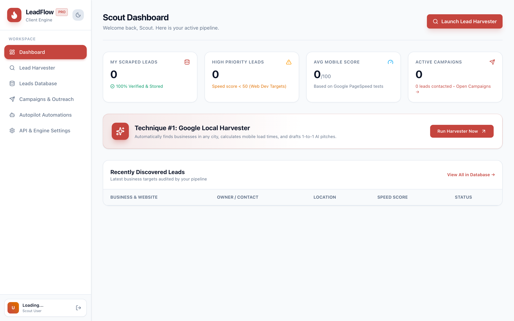
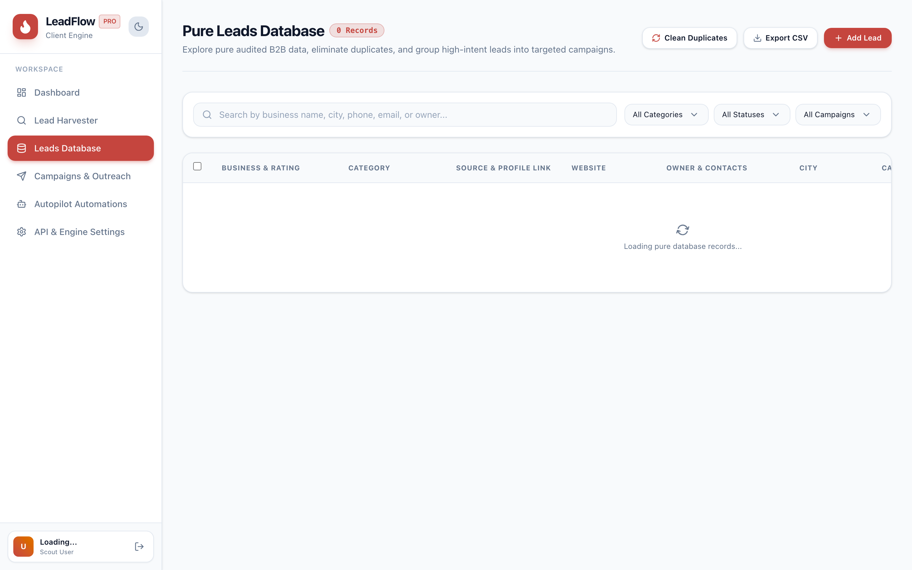
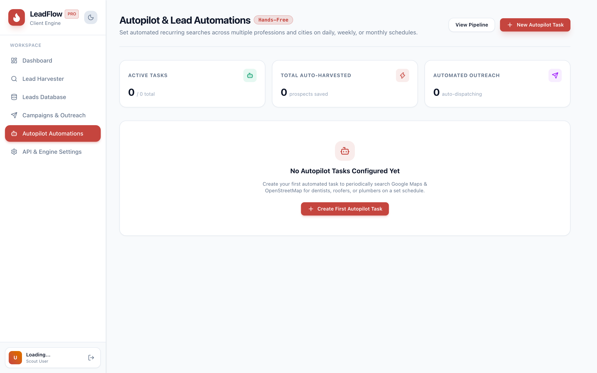
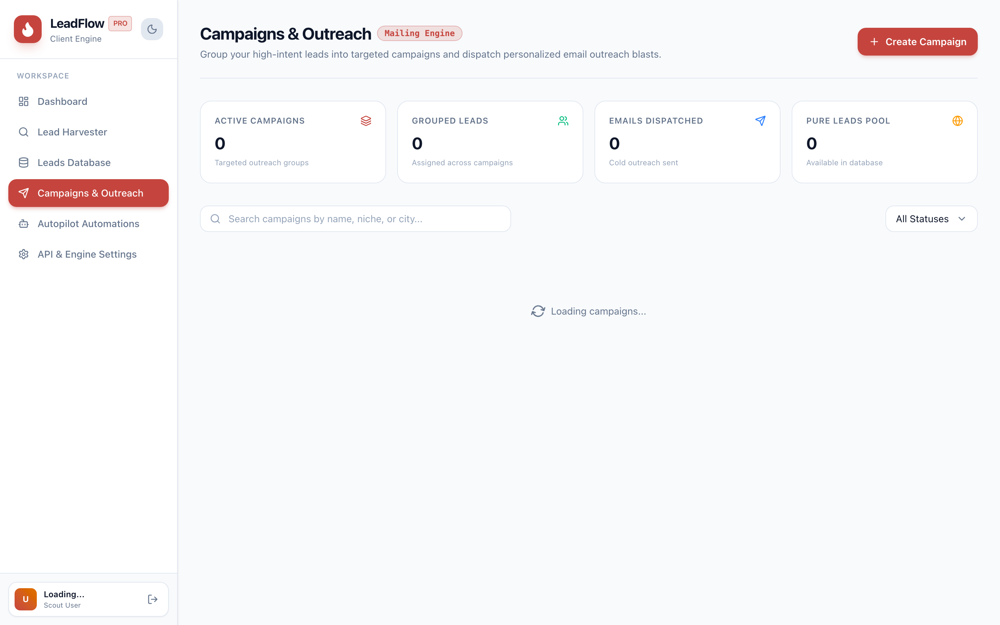

# ⚡ myLeads

> **Autonomous Multi-Source Lead Generation, Enrichment & Outreach CRM**  
> Discover high-ticket B2B clients, audit their digital presence, generate tailored pitch angles, and dispatch automated outreach campaigns — all from a single unified workspace.

---

## 📸 Visual Showcase

### 1. Multi-Channel Lead Scraper & Harvester
Discover verified leads across Google Maps, Yelp, LinkedIn, Instagram, Facebook, and Web Dorks with real-time deep enrichment.


---

### 2. High-Altitude Performance & Pipeline Dashboard
Track your revenue pipeline, conversion funnels, channel ROI, and active campaign performance in real time.


---

### 3. Verified Leads CRM & 1-Click Verification
Manage contacts, inspect automated website audits, track deal values, and launch 1-click profile and map navigations.


---

### 4. Autopilot Scheduling & Recurring Scraping
Set recurring discovery schedules that wake up, harvest fresh leads, perform technical audits, and queue outreach automatically.


---

### 5. Multi-Step Outreach Campaigns & SMTP Dispatcher
Draft personalized pitch sequences powered by AI website audits and dispatch live cold emails via your custom SMTP server.


---

## ✨ Key Features

- **🌐 Multi-Source Lead Discovery**
  - **Google Maps Places API & Scraper**: Search any niche and locality for businesses, addresses, ratings, and phone numbers.
  - **LinkedIn B2B Precision Search**: Search executive profiles and decision makers with direct 1-click profile validation.
  - **Yelp Fusion Engine**: Target local businesses with rich review and rating data.
  - **Social Profiles (Instagram & Facebook)**: Discover digital agencies, e-commerce brands, and local storefronts.

- **🔍 Automated Website & SEO Audits**
  - Tech stack detection (WordPress, Shopify, Next.js, Webflow, Wix, etc.).
  - Performance and Core Web Vitals profiling.
  - SSL / HTTPS verification, viewport responsiveness, and metadata inspection.
  - Identification of pain points (missing meta tags, slow load times, unoptimized assets) for pitch ammunition.

- **🤖 AI-Powered Pitch Generation**
  - Automatically synthesizes audit findings into highly specific, personalized cold outreach emails.
  - Highlights exact technical fixes to build instant trust with prospects.

- **📬 Cold Email Dispatcher & Custom SMTP**
  - Integrated with Nodemailer for live email dispatching.
  - Supports custom SMTP configuration (Gmail, SendGrid, Amazon SES, Mailgun, custom servers) configured directly in user settings.
  - Built-in Simulation Mode for safe previewing and campaign testing.

- **📊 Comprehensive B2B CRM Pipeline**
  - Kanban / Table pipeline states: `New` → `Contacted` → `Qualified` → `In Progress` → `Won` / `Lost`.
  - Deal valuation, custom notes, tagging, and CSV lead export.

- **⚙️ Autopilot Background Tasks**
  - Set hourly, daily, or weekly recurring jobs for uninterrupted lead acquisition.

- **🔐 Multi-Tenant Architecture & Admin Portal**
  - Role-Based Access Control (Admin and Standard User roles).
  - Telemetry and user management dashboard for system administrators.

---

## 🛠️ Tech Stack

- **Framework**: [Next.js 15](https://nextjs.org/) (App Router, Server Components, API Route Handlers)
- **Language**: [TypeScript](https://www.typescriptlang.org/)
- **Styling**: [Tailwind CSS](https://tailwindcss.com/) & [Lucide Icons](https://lucide.dev/)
- **Database Engine**: Persistent Local JSON Storage with atomic file writes and schema migrations
- **Email Engine**: [Nodemailer](https://nodemailer.com/) (Live SMTP + Simulation Mode)
- **Auditing Tools**: Python Acquisition Engine (`BeautifulSoup4`, `requests`, `urllib3`)

---

## 🚀 Getting Started

### Prerequisites
- Node.js 18.x or higher
- npm, yarn, or pnpm

### 1. Clone the Repository
```bash
git clone https://github.com/uchitchakma/myLeads.git
cd myLeads
```

### 2. Install Dependencies
```bash
npm install
```

### 3. Initialize the Local Database
Create your local database file from the clean template:
```bash
cp myleads_database.example.json myleads_database.json
```

*(Note: `myleads_database.json` is strictly ignored in `.gitignore` to prevent any personal API keys or SMTP secrets from leaking.)*

### 4. Start the Development Server
```bash
npm run dev
```

Open [http://localhost:3000](http://localhost:3000) in your browser.

### 5. Default Credentials for Testing
You can log in immediately using the pre-seeded demo accounts:

| Role | Email | Password |
| :--- | :--- | :--- |
| **Standard User** | `alex@leadflow.local` | `user123` |
| **Administrator** | `admin@leadflow.local` | `admin123` |

*(Or click **Sign Up** to create a fresh workspace account).*

---

## ⚙️ Configuration & API Keys

You can use **myLeads** with simulated demo data out of the box, or connect your own API keys in **Settings (`/settings`)**:

- **Google Maps API**: Enables live Google Places B2B discovery.
- **Yelp API Key**: Connects Yelp Fusion for local business research.
- **Gemini / AI Key**: Powers intelligent personalized pitch generation.
- **Custom SMTP**: Enter your SMTP host, port, user, and app password for 1-click live cold outreach.

---

## 🔒 Security & Privacy

- **Zero-Secret Repository**: All database records, session cookies, API tokens, and SMTP credentials remain stored in your local git-ignored database file.
- **Sanitized Exports**: Exporting data or sharing templates strips all sensitive authentication metadata.

---

## 📄 License

This project is licensed under the MIT License — see the [LICENSE](LICENSE) file for details.
